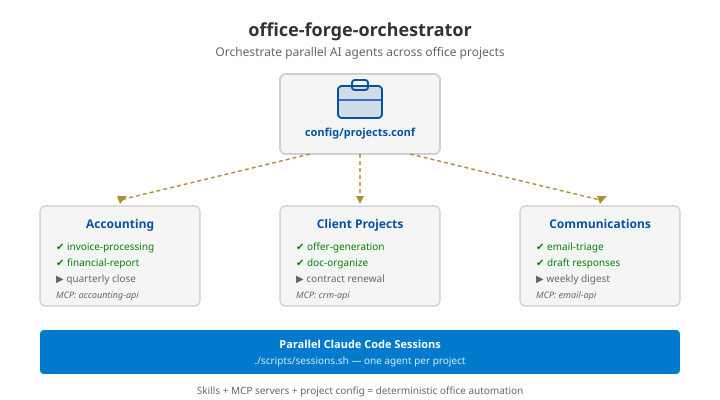

<!-- markdownlint-disable MD033 -->
# office-forge-orchestrator

Orchestrate parallel AI agents across office projects
(invoices, contracts, reports, email) from a single
workspace — the way [polyforge](https://github.com/qte77/polyforge) manages dev repos.

**For** office workers and ops teams running Claude Code
across multiple projects simultaneously.
**Run** `./scripts/sessions.sh` to open parallel agent
sessions — one per project.

## Quick Start

```bash
./scripts/status.sh              # See all managed projects
./scripts/sessions.sh            # Parallel CC sessions
./scripts/run.sh "task" ./dir/   # Run task across projects
```

Projects: edit `config/projects.conf`. Credentials:
copy `config/env.example`; its names match the `${VAR}` references in
`mcp/*.json`.

Both scripts start Claude with `--add-dir` pointing at this repo, so the
[skills](.claude/skills/) load in every project. `run.sh` runs headless with
`--permission-prompts none` and prints JSON (`.result`, `.is_error`,
`.total_cost_usd`) on stdout:

| Env var                        | Default       | Effect                    |
|--------------------------------|---------------|---------------------------|
| `OFFICE_FORGE_PERMISSION_MODE` | `acceptEdits` | `run.sh` permission mode  |
| `OFFICE_FORGE_MAX_BUDGET_USD`  | `5`           | `run.sh` USD cap per task |

<details>
  <summary>Workspace preview — orchestrator concept with parallel agent sessions</summary>
  
</details>

## Docs

- [Skills](.claude/skills/) — deterministic office workflows (invoice, contract, report)
- [MCP servers](mcp/) — business API configs (accounting, CRM, email)
- [Templates](templates/) — project scaffolds for common scenarios
- [Business-process baseline](https://github.com/qte77/qte77/blob/main/docs/cto-handbook-mapping.md) — how the office-loop (business-process / IT) maps to the Startup CTO Handbook (estate-level note in qte77)
